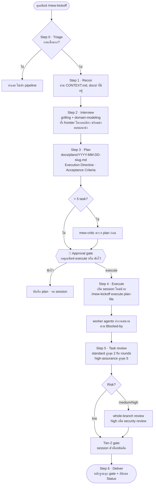

<div align="center">

# 🚀 mew-kickoff

**Pipeline "สัมภาษณ์จนถึงส่งมอบ" สำหรับ AI coding agent — ให้โมเดลตัวท็อปคิด ให้ตัวเล็กผลิต แล้วให้ตัวท็อปตรวจปิดงาน**

   

</div>

---

## มันคืออะไร

`mew-kickoff` คือ **skill** ตัวเดียวที่เปลี่ยนการ "สั่ง AI เขียนโค้ด" ให้เป็น pipeline ที่มีขั้นตอน มี gate และมีคนตรวจงานเสมอ:

1. AI **สัมภาษณ์**คุณเป็นรอบ — ถามทุกข้อที่ถามได้ตอนนี้พร้อมคำตอบแนะนำ แล้วรอคุณตอบ ไม่เดาแทนคุณ
2. เขียน **plan** ที่ระบุว่างานแต่ละชิ้นให้ agent ตัวไหนทำ ด้วยโมเดลอะไร
3. หยุดรอคุณ **approve** ก่อนลงมือทุกครั้ง
4. กระจายงานให้ **worker agent** ทำในบริบทสด แยกจากบทสนทนาหลัก
5. **reviewer** ตรวจงาน risk medium/high และรัน test เฉพาะส่วนเอง (งาน low risk ใช้ผล verify ของ worker) งานเสี่ยงจึงเพิ่ม whole-branch/security review แล้วโมเดลตัวท็อปปิดงาน
6. ส่งมอบพร้อมหลักฐานว่าผ่าน gate ไหนบ้าง

ใช้ได้กับ **Claude Code**, **OpenAI Codex CLI** และ **xAI Grok CLI** จาก source เดียวกัน

> ได้แรงบันดาลใจจาก [mattpocock/skills](https://github.com/mattpocock/skills) และ [superpowers](https://github.com/obra/superpowers) ขอบคุณทั้งสองโปรเจกต์

---

## สำหรับนักเรียน: ติดตั้งและเริ่มใช้

### mew-kickoff คืออะไร

สกิลที่มิวใช้ทำงานชิ้นใหญ่กับ AI ทุกวัน เป็นตัวเดียวกับที่มิวใช้ ไม่ใช่รุ่นย่อ AI จะสัมภาษณ์คุณเป็นรอบ เขียนแผน แล้วหยุดรอคุณอนุมัติ พออนุมัติแล้ว คุณเปิด session ใหม่สั่ง execute แล้ว AI จะแจกงานให้ agent ย่อยทำ ตรวจงาน และส่งมอบพร้อมหลักฐาน

### ต้องมีอะไร

- แผนรายเดือนราว $100 ของเครื่องมือใดเครื่องมือหนึ่ง: Claude Code (Max 5x), Codex (ChatGPT Pro) หรือ Cursor (Super) แผน $20 ไม่พอสำหรับงานแบบในคอร์ส
- git ในเครื่อง
- Node.js (คำสั่ง `npx`) ใช้ติดตั้งสกิล `grilling` และ `domain-modeling` ที่ mew-kickoff ใช้ตอนสัมภาษณ์ ถ้ายังไม่มี ให้ AI ติดตั้งให้ก่อน

### ติดตั้ง: คัดลอกข้อความนี้ไปส่งให้ AI ของคุณ

**Mac**

```text
ช่วยติดตั้ง mew-kickoff ให้ฉัน ทำทีละข้อ แล้วสรุปผลให้ฉันฟัง
1. ถ้ายังไม่มีโฟลเดอร์ ~/mew-kickoff ให้รัน git clone https://github.com/mewic/mew-kickoff.git ~/mew-kickoff
   ถ้ามีแล้ว ให้รัน git -C ~/mew-kickoff pull
2. รัน bash ~/mew-kickoff/install.sh
3. รัน bash ~/mew-kickoff/skills/mew-kickoff/scripts/smoke.sh แล้วบอกฉันว่าบรรทัดสุดท้ายเป็น SMOKE: PASS หรือไม่ ถ้ามีบรรทัดที่ขึ้นต้นด้วย FAIL ให้อธิบายว่าแต่ละบรรทัดแปลว่าอะไร
4. เตือนฉันว่าห้ามลบหรือย้ายโฟลเดอร์ ~/mew-kickoff เพราะสกิลลิงก์มาที่โฟลเดอร์นี้
5. บอกให้ฉันปิด session นี้แล้วเปิดใหม่
```

**Windows**

Windows ต้องใช้สิทธิ์พิเศษในการสร้าง symlink จึงใช้วิธีคัดลอกไฟล์ชุดเดียวกันไปไว้ที่เดียวกันแทน ผลคือต้องส่งข้อความนี้ให้ AI อีกครั้งทุกครั้งที่อัปเดต

```text
ช่วยติดตั้ง mew-kickoff บน Windows ให้ฉัน ใช้ PowerShell ทำทีละข้อ แล้วสรุปผลให้ฉันฟัง ห้ามสร้าง symlink ให้คัดลอกไฟล์แทน
1. ถ้ายังไม่มีโฟลเดอร์ %USERPROFILE%\mew-kickoff ให้ git clone https://github.com/mewic/mew-kickoff.git ไปไว้ที่นั่น
   ถ้ามีแล้ว ให้รัน git pull ในโฟลเดอร์นั้น
2. ถ้ายังไม่มีโฟลเดอร์ %USERPROFILE%\.agents\skills\grilling ให้รัน
   npx --yes skills@latest add mattpocock/skills -s grilling domain-modeling tdd research wayfinder -g -a "*" -y
3. คัดลอกโฟลเดอร์ %USERPROFILE%\mew-kickoff\skills\mew-kickoff ทั้งโฟลเดอร์ไปไว้ที่ 3 ที่นี้ ถ้าที่ปลายทางมีโฟลเดอร์ mew-kickoff เดิม ให้ลบเฉพาะโฟลเดอร์ mew-kickoff นั้นก่อนแล้วค่อยคัดลอก
   - %USERPROFILE%\.claude\skills\mew-kickoff
   - %USERPROFILE%\.agents\skills\mew-kickoff
   - %USERPROFILE%\.cursor\skills\mew-kickoff
4. คัดลอกไฟล์ agent ไปทับของเดิม สร้างโฟลเดอร์ถ้ายังไม่มี
   - %USERPROFILE%\mew-kickoff\agents\claude\*.md ไปที่ %USERPROFILE%\.claude\agents\
   - %USERPROFILE%\mew-kickoff\agents\codex\*.toml ไปที่ %USERPROFILE%\.codex\agents\
   - %USERPROFILE%\mew-kickoff\agents\cursor\*.md ไปที่ %USERPROFILE%\.cursor\agents\
5. ห้ามแตะไฟล์อื่นในโฟลเดอร์เหล่านี้ สรุปให้ฉันว่าคัดลอกอะไรไปไว้ที่ไหน แล้วบอกให้ฉันปิด session นี้แล้วเปิดใหม่
```

บน Windows ไม่ต้องรัน `smoke.sh` เพราะมันเช็ค symlink ที่ Windows ไม่ได้ใช้ ขั้นตอน Windows ตรวจกับเอกสารของแต่ละเครื่องมือแล้ว แต่ยังไม่ได้ลองบนเครื่อง Windows จริง ที่เก็บสกิลและ agent ของแต่ละเครื่องมือ (`~` ในเอกสารคือ `%USERPROFILE%` บน Windows):

| เครื่องมือ | โฟลเดอร์สกิล | โฟลเดอร์ agent | เอกสาร |
|---|---|---|---|
| Claude Code | `%USERPROFILE%\.claude\skills\` | `%USERPROFILE%\.claude\agents\` | [skills](https://code.claude.com/docs/en/skills) · [subagents](https://code.claude.com/docs/en/sub-agents) · [settings](https://code.claude.com/docs/en/settings) ("On Windows, `~/.claude` means `%USERPROFILE%\.claude`") |
| Codex | `%USERPROFILE%\.agents\skills\` | `%USERPROFILE%\.codex\agents\` | [skills](https://learn.chatgpt.com/docs/build-skills) · [subagents](https://learn.chatgpt.com/docs/agent-configuration/subagents) · [Windows](https://learn.chatgpt.com/docs/windows/windows-sandbox) |
| Cursor | `%USERPROFILE%\.cursor\skills\` | `%USERPROFILE%\.cursor\agents\` | [skills](https://cursor.com/docs/context/skills) · [subagents](https://cursor.com/docs/agent/subagents) |

### เริ่มใช้

1. เปิด CLI ในโฟลเดอร์โปรเจกต์ของ AI OS เช่น `ร้านของฉัน/line-bot/` อย่าเริ่มที่รากของ AI OS
2. พิมพ์ชื่อสกิลตามด้วยสิ่งที่อยากได้
   - Claude Code และ Cursor: `/mew-kickoff อยากได้ LINE ที่ตอบคำถามลูกค้าและรับจองเอง`
   - Codex: `$mew-kickoff อยากได้ LINE ที่ตอบคำถามลูกค้าและรับจองเอง`
3. AI อ่าน `AGENTS.md`, `business.md` และ `brand.md` ที่รากของ AI OS ก่อน (อ่านอย่างเดียว ไม่แก้) แล้วถามเป็นรอบ ทุกข้อมีเลขและคำตอบแนะนำ ตอบตามเลขข้อ หรือบอกว่า "ตามที่แนะนำ" ก็ได้
4. แผนเขียนเป็นภาษาที่ `AGENTS.md` กำหนด ถ้าตั้ง AI OS ตามคอร์ส แผนจะเป็นภาษาไทย

### หลังอนุมัติแผน: เปิด session ใหม่เพื่อ execute

ตอบ `execute` ที่จุดอนุมัติ AI จะจบ session นี้และให้ข้อความแรกสำหรับ session ใหม่ ปิดแล้วเปิด CLI ใหม่ในโฟลเดอร์โปรเจกต์เดิม แล้ววางข้อความนั้น เช่น `/mew-kickoff execute docs/plans/<ไฟล์แผน>.md` (Codex ใช้ `$mew-kickoff execute ...`) session ใหม่เริ่มด้วยบริบทสะอาด ไม่แบกบทสนทนาตอนสัมภาษณ์ไปด้วย จึงถูกกว่าและแม่นกว่า

### ถ้าเจอ usage limit

- ลด effort ลง: Claude Code พิมพ์ `/effort high` หรือ `/effort medium` · Codex เลือก reasoning ที่ต่ำลงใน `/model` · Cursor ไม่มี `/effort` ให้เปลี่ยนโมเดลของแชตเป็นตัวที่ถูกลง
- ถ้าโควตาหมดกลางงาน รอรอบรีเซ็ต แล้วเปิด session ใหม่ด้วยข้อความ execute เดิม แผนและบันทึกความคืบหน้าอยู่ในไฟล์ AI จึงทำต่อจากจุดที่ค้างได้

### อัปเดต

- Mac: รัน `git -C ~/mew-kickoff pull` แล้วเปิด session ใหม่
- Windows: ส่งข้อความติดตั้ง Windows ด้านบนให้ AI อีกครั้ง (มันจะ pull แล้วคัดลอกใหม่) แล้วเปิด session ใหม่

---

## หลักคิด 3 ข้อ

| หลัก | ความหมาย |
|---|---|
| **Effort economy** | จ่าย effort สูงสุดเฉพาะจุดที่ "การตัดสินใจ" ทบต้น: สัมภาษณ์, spec, review ไม่ใช่ตอนพิมพ์โค้ด |
| **Context economy** | session หลักเก็บบริบทของการสัมภาษณ์กับ plan ให้สะอาด งานผลิตไปเผาบริบทสดของ worker แทน state อยู่บนดิสก์ (plan, ledger, report) เพื่อให้ harness compact ได้ ไม่ใช้ context 1M เพื่อเลี่ยง compaction |
| **Review independence** | คนเขียนไม่ใช่คนตัดสิน worker ผลิต, reviewer ตรวจ, session ปิดงาน |

ทำไมถึงเชื่อแบบนี้: เราวัดจริงจาก transcript 5 สัปดาห์ ($16k เทียบราคา API) พบว่า **65% ของต้นทุนคือ session หลักอ่าน context ยาว ๆ ซ้ำทุก turn** ส่วน output ที่ worker ผลิตทั้งหมดรวมกันไม่ถึง 1% ดังนั้นสถาปัตยกรรม "ท็อปคิด เล็กผลิต" ถูกแล้ว สิ่งที่ต้องคุมคือขนาดบริบทของ session หลัก (รายละเอียดใน [`docs/HANDOFF.md`](docs/HANDOFF.md)) audit รอบ 2026-09-24/25 ยืนยันซ้ำ: 5B cache-read tokens ใน 2 วัน, subagent 67%, context เฉลี่ยของ session หลัก 396K ต่อ call จึงเป็นที่มาของการปรับใน [อัปเดตล่าสุด](#อัปเดตล่าสุด-2026-09-25)

---

## ภาพรวม pipeline



---

## ทีม agent 5 ตัว + heavy reviewer เมื่อจำเป็น

| Agent | หน้าที่ | Claude Code | Codex | Grok |
|---|---|---|---|---|
| `mew-worker` | งานที่ spec ชัด: โค้ด, test, refactor, ผลิตชิ้นงานด้วย tool **(default)** | Sonnet 5 · high | gpt-6-astra · high | grok-4.7-build-fast · high |
| `mew-worker-heavy` | งานซับซ้อน หลายไฟล์ debug ยาก งานที่แตะ auth หรือ payment | Opus 5.5 · xhigh | gpt-6-sol · xhigh | grok-4.7-build-fast · xhigh |
| `mew-worker-mech` | งานกลไกล้วน: rename, แก้ typo, boilerplate ซ้ำ ๆ | Haiku 4.5 | gpt-5.6-luna · medium | grok-4.7-build-fast · low |
| `mew-reviewer` | ตรวจ task และ standard branch review ด้วย scoped test | Sonnet 5 · high | gpt-6-astra · high | grok-4.7-build-fast · high |
| `mew-reviewer-heavy` | whole-branch/security review เฉพาะ high-assurance | Opus override | gpt-6-sol · xhigh | grok-4.7-build-fast · xhigh |
| `mew-critic` | ตรวจงานที่ไม่ใช่โค้ดและตรวจ plan ด้วยบริบทสด ไม่เห็นบทสนทนา | Opus 5.5 · high | gpt-6-astra · high | grok-4.7-build-fast · high |

ตัว **session** (คุณคุยด้วย) ใช้โมเดลท็อปสุดที่มีที่ effort สูงสุด และลดลงหนึ่งขั้นตอนกระจายงานใน Step 4

Codex dispatch ทุก agent ด้วย `fork_turns="none"` แล้วส่งเฉพาะ brief/path ที่จำเป็น ทุก agent รายงานกลับมาไม่เกิน 150 คำและเขียนหลักฐานลงไฟล์ เพื่อไม่ให้บทสนทนาหลักบวม

---

## ติดตั้ง

### 1) เตรียม CLI ที่จะใช้

> `install.sh` ในข้อ 2 จะเช็คของพวกนี้ให้และติดตั้งให้ถ้ายังไม่มี ข้อนี้อธิบายว่ามันคืออะไรและใช้คำสั่งอะไร เผื่อต้องทำเอง

<details>
<summary><b>Claude Code</b></summary>

ต้องมี skill ชุดของ Matt Pocock (`grilling`, `domain-modeling`) เท่านั้น — ไม่ต้องใช้ plugin `superpowers` แล้ว ตั้งแต่ 2026-09-25 execute loop อยู่ใน `adapters/loop.md` และใช้ร่วมกันทุก CLI

```bash
npx --yes skills@latest add mattpocock/skills -s grilling domain-modeling tdd research wayfinder -g -a '*' -y
```

คำสั่งนี้ติดตั้ง `grilling`, `domain-modeling`, `tdd`, `research`, `wayfinder` ให้ทุก agent (`*`) โดยไม่ถามอะไร จะได้ใช้ร่วมกับ Codex, Grok และ Cursor
</details>

<details>
<summary><b>OpenAI Codex CLI</b></summary>

```bash
npx --yes skills@latest add mattpocock/skills -s grilling domain-modeling tdd research wayfinder -g -a '*' -y
codex features list | grep multi_agent   # ต้องเป็น stable true
```

Codex อ่าน skill จาก `~/.agents/skills/` และ agent จาก `~/.codex/agents/*.toml` ซึ่ง `install.sh` จะวางให้
</details>

<details>
<summary><b>xAI Grok CLI</b></summary>

```bash
npx --yes skills@latest add mattpocock/skills -s grilling domain-modeling tdd research wayfinder -g -a '*' -y
```

Grok อ่าน skill จาก `~/.grok/skills/` และ `~/.agents/skills/` และอ่าน agent จาก `~/.grok/agents/*.md`
</details>

### 2) clone แล้วรัน install.sh

```bash
git clone git@github.com:mewic/mew-kickoff.git ~/projects/mew-kickoff
~/projects/mew-kickoff/install.sh
```

`install.sh` ทำ 2 อย่าง: ติดตั้ง prerequisite ที่ยังขาด (skill ชุดของ Matt Pocock ถ้ายังไม่มี `grilling`/`domain-modeling`) แล้วสร้าง symlink จาก directory ของแต่ละ CLI มาที่ repo นี้ ไม่ copy ไฟล์ แก้ที่ repo ที่เดียวทุก CLI เห็นหมด รันซ้ำได้เสมอ

### 3) เปิด session ใหม่ แล้วเช็ค

CLI ทุกตัวอ่าน skill และ agent ตอนเริ่ม session เท่านั้น ปิดแล้วเปิดใหม่ก่อน จากนั้น:

```bash
bash ~/projects/mew-kickoff/skills/mew-kickoff/scripts/smoke.sh
```

ต้องเห็น `SMOKE: PASS` script นี้เช็ค pointer ทุกตัวที่ skill พึ่งพา รวมถึง model economy, fresh-context rule, agent definitions, symlink และความเป็นกลางของ core

---

## วิธีใช้

| ทำอะไร | Claude Code | Codex | Grok |
|---|---|---|---|
| เริ่มงานใหม่ | `/mew-kickoff` | `$mew-kickoff` | `/mew-kickoff` |
| รัน plan ที่ approve แล้ว | `/mew-kickoff execute docs/plans/<file>.md` | `$mew-kickoff execute docs/plans/<file>.md` | `/mew-kickoff execute docs/plans/<file>.md` |

**สิ่งที่จะเกิดขึ้น**

1. ถ้างานไม่มี design decision, ความเสี่ยงต่ำ และตรวจจบได้เป็นหนึ่ง bounded change จะเข้า off-ramp โดยไม่ดูจำนวนไฟล์ พิมพ์ `เข้า pipeline เต็ม` ถ้าอยากบังคับ
2. AI ถามทั้ง frontier ในรอบเดียว พร้อมคำตอบที่แนะนำ **ข้อเท็จจริง**มันไปหาเอง **การตัดสินใจ**มันจะรอคุณเสมอ
3. ได้ plan ที่มี Execution Directive, Acceptance Criteria และ Assurance/Budget ระบุ risk, fix-round ceiling, concurrency และ usage checkpoints
4. AI หยุดที่ **approval gate** ตอบ `execute` เพื่อไปต่อ หรือ `พักไว้` เพื่อเก็บ plan ไว้ทำวันหลัง
5. ตอน execute แนะนำให้ **เปิด session ใหม่** แล้วสั่ง `execute <plan-file>` เพื่อให้บริบทสะอาด และลด effort ของ session ลงหนึ่งขั้น (`/effort high` ใน Claude Code) แล้วกลับเป็นสูงสุดตอน gate สุดท้าย
6. review ตาม risk: low ใช้ผล verify ของ worker แล้วรัน full suite เข้า final gate, medium ให้ `mew-reviewer` ตรวจทุก task และเพิ่ม whole-branch review, high เพิ่ม security review
7. งานเสร็จ AI รายงานหลักฐาน build/test, criteria checklist, usage checkpoints และอัปเดต Status ใน plan

**เอกสารที่ pipeline สร้างในโปรเจกต์ของคุณ**

```
CONTEXT.md            glossary ของโปรเจกต์ (อัปเดตในที่ ไม่สร้างใหม่)
docs/adr/             decision records
docs/plans/           plan ต่อ 1 งาน ขึ้นต้นด้วยวันที่ ลบได้หลังส่งมอบ
docs/plans/reports/   รายงานเต็มของ worker/reviewer
docs/research/        ผล research จาก primary source
docs/deliverables/    งานที่ไม่ใช่โค้ด เช่น strategy doc
```

---

## โครงสร้าง repo

```
skills/mew-kickoff/
  SKILL.md                 กระบวนการ กลางทุก CLI
  adapters/claude.md       วิธี dispatch, effort, security review, ตาราง model สำหรับ Claude Code
  adapters/codex.md        เช่นเดียวกันสำหรับ Codex
  adapters/grok.md         เช่นเดียวกันสำหรับ Grok
  adapters/loop.md         execute loop กลาง ใช้ร่วมกันทุก CLI
  map.md                   วิธีเขียน "map" เมื่องานใหญ่เกิน 1 plan
  ultracode.md             เกณฑ์เสนอ review แบบ multi-agent (Claude Code)
  agents/openai.yaml       metadata สำหรับ Codex
  scripts/smoke.sh         ตัวเช็คว่าทุก pointer ยังใช้ได้
agents/claude|codex|grok/  นิยาม 5 base roles; Codex/Grok มี conditional heavy reviewer
docs/                      plan, รายงาน critic, ผลทดสอบข้าม CLI, research, handoff
scripts/                   script วัด token และต้นทุนจาก transcript ของ Claude Code
install.sh                 สร้าง symlink เข้า CLI ทั้งสาม
```

---

## ปรับให้เป็นของคุณ

| อยากเปลี่ยน | แก้ที่ไหน |
|---|---|
| ภาษาเอกสาร (plan, ADR, CONTEXT.md) | เขียนกฎภาษาเอกสารใน `AGENTS.md` หรือ `CLAUDE.md` ของคุณ เช่น `ภาษาเอกสาร: เขียนเอกสารทุกไฟล์เป็นภาษาไทย` ไม่ต้องแก้ skill ถ้าไม่ได้ตั้ง เอกสารเทคนิคเป็นภาษาอังกฤษ (กฎภาษาแชตไม่นับ) |
| model หรือ effort ของ agent | Claude: frontmatter ใน `agents/claude/*.md` · Codex: `model` และ `model_reasoning_effort` ใน `agents/codex/*.toml` · Grok: `model:` และ `effort:` ใน `agents/grok/*.md` |
| model ของ session | Claude: `/model` และ `/effort` · Codex: `~/.codex/config.toml` · Grok: `~/.grok/config.toml` |
| ภาษาที่ใช้สัมภาษณ์ | หัวข้อ **Language** ใน `SKILL.md` (ค่าเริ่มต้น: สัมภาษณ์ไทย) |
| เพิ่ม agent ตัวที่ 6 | เพิ่มไฟล์ใหม่ใน `agents/<cli>/` แล้วอ้างชื่อใน Execution Directive อย่าแก้ไฟล์ agent ระหว่างที่มี session รันอยู่ |

แก้เสร็จให้รัน `smoke.sh` และเปิด session ใหม่เสมอ

---

## คำถามที่พบบ่อย

**พิมพ์ `/mew-kickoff` แล้วไม่ขึ้น** — เปิด session ใหม่หรือยัง? skill ถูกอ่านตอนเริ่ม session และตั้งใจให้ AI มองไม่เห็นในรายการอัตโนมัติ คุณต้องเป็นคนเรียกเอง

**AI บอกว่า Skill tool ปฏิเสธ `grill-with-docs`** — คุณใช้ skill เวอร์ชันเก่า อัปเดต repo แล้วรัน `smoke.sh`

**แก้ไฟล์ agent แล้วไม่มีผล** — ไฟล์ agent มีผลกับ session ใหม่เท่านั้น ทุก CLI

**ทำไม Codex แยก Sol/Astra/Luna** — usage allowance คิดตาม model, context, reasoning และ tool work แม้ใช้ subscription จึงใช้ Sol 6 เฉพาะงานหนัก, Astra กับงานผลิต/ตรวจทั่วไป และ Luna กับงานกลไก ส่วน Grok มีโมเดลเดียว (4.7) จึงแยก role ด้วย effort อย่างเดียว

**ช้าและกิน token** — เช็คว่า plan ใช้ `standard` หรือ `high-assurance`, Codex agent มี `fork_turns="none"`, และ role mapping ผ่าน smoke แล้ว ดู usage ก่อน execute/หลังแต่ละ frontier/ก่อน final gate; ถึง budget ceiling ให้ session ตัดสิน ไม่เปิด agent เพิ่มอัตโนมัติ

---

## อัปเดตล่าสุด 2026-09-25

- **ไม่ต้องใช้ plugin `superpowers` แล้ว** `adapters/loop.md` เป็น execute loop กลางของ Claude Code, Codex, Grok และ Cursor ปิด plugin ได้เลย (`claude plugins disable superpowers`)
- **review ตาม risk** `mew-reviewer` ตรวจเฉพาะ task risk medium/high งาน low ใช้ผล verify ของ worker + final gate
- **auto-compact ที่ 200K** Opus 5.5/Fable 5.1 มีแต่ window 1M จึงคุมด้วย `"autoCompactWindow": 300000` ใน `~/.claude/settings.json` (หรือ `/autocompact`) ให้ compact ตั้งแต่ ~300K state อยู่ในไฟล์ plan/ledger/report
- **ตาราง model ใหม่** Claude: Sonnet/Opus/Haiku (economy) สลับเป็น Fable ทั้งหมดด้วย `scripts/agent-models.sh fable` เมื่อจำเป็น — ข้อเท็จจริงจาก support.claude.com: Fable นับใน weekly allowance เดียวกับ Opus และแถบ Fable คือเพดาน 50% ในนั้น ไม่ใช่โควตาเพิ่ม · Codex: gpt-6-sol / gpt-6-astra / gpt-5.6-luna · Grok: `grok-4.7-build-fast` ตัวเดียว แยก role ด้วย effort
- **กฎกลาง 3 CLI** อยู่ที่ `~/.agents/SKILL-PRECEDENCE.md` (Claude อ่านผ่าน `@` ใน CLAUDE.md, Codex/Grok ผ่าน AGENTS.md symlink) แทน skill พิธีกรรมของ superpowers/ponytail

อัปเดตแล้วรัน `install.sh` ซ้ำ, `smoke.sh` ต้อง PASS, แล้วเปิด session ใหม่ทุก CLI

---

## เครดิต

- [mattpocock/skills](https://github.com/mattpocock/skills) — grilling, domain-modeling, wayfinder, writing-for-agents และวิธีคิดเรื่อง skill ทั้งหมด
- [superpowers](https://github.com/obra/superpowers) — ต้นแบบของ execute loop (ledger, review package, fix rounds) ที่ `adapters/loop.md` ย่อมาใช้
- [agentskills.io](https://agentskills.io) — สเปก SKILL.md ที่ทำให้ใช้ข้าม CLI ได้

Public repo · ใครก็ clone ไปใช้ได้ · นักเรียนของ Mew ถามได้ในคลาส
